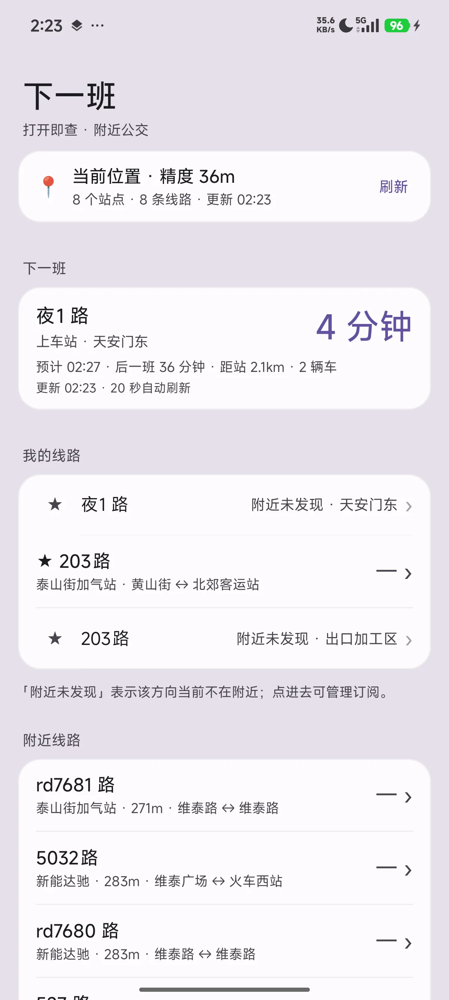

# 下一班 · nextbus

一支打开即用的公交到站小工具：**不跑后台、不发定时通知、不占用灵动岛**。需要查车时打开 App，首页直接列附近公交；订阅过的线路置顶。


## 功能

- **打开即查**：有定位权限时，进入首页自动查当前位置附近站点与线路；没有权限时可用「常去地点」兜底。
- **详情优先**：点首页、附近页或订阅页的线路，先看线路详情、途经站点和上车站；订阅/取消只在这里点按钮完成。
- **附近线路**：按站点分组查看线路、方向、首末班和到站时间；不再询问绑定地点。
- **地图看站与走向**：首页或附近页点「在地图上查看」，我的位置用蓝色「我」标出；选一条线路后只显示这条线的站点、站名和走向折线，并用绿色「车」标出最近一辆在线公交（前台每 15 秒刷新），支持「看全线 / 回到附近」。
- **快速定位**：家 / 公司 / 学校等地点只用于快速定位，不绑定订阅。
- **城市自动识别**：优先用当前定位城市；失败时回退到设置里的城市或已设地点。
- **无后台**：没有前台服务、精确闹钟、开机自启、通知渠道或灵动岛代码。

## 构建

需要 JDK 17、Android SDK 33：

```bash
./gradlew assembleDebug
```

Windows：

```bat
gradlew.bat assembleDebug
```

产物在 `app/build/outputs/apk/debug/app-debug.apk`。

高德 Key 可写在 `local.properties`（定位和地图共用；没有 key 时定位回退系统定位，地图入口隐藏）：

```properties
sdk.dir=D:\\Android\\Sdk
amap.key=你的高德Key
```

没有 key 时会回退系统定位。签名配置可选，见 `app/build.gradle.kts`。

## 使用

1. 安装后打开 App。
2. 首次进入会请求定位权限；允许后首页自动查询。拒绝也能用「常去地点」查询。
3. 点首页「附近线路」中的线路，先查看详情和途经站点；在详情底部可订阅，订阅后出现在「我的线路」并置顶。
4. 在「更多 → 城市」里可自动识别、用已设地点或搜索城市名。
5. 「附近公交」页可按站点查看全部线路，也可点「查看全部附近站点」进入。
6. 首页或附近页点「在地图上查看」进入地图；点线路条切换走向，点站点标记查看站名/经过线路；看全线会隐藏密集站名，点「回到附近」恢复。

## 工作方式

- 所有查询都在前台完成：定位 → 附近站点 → 并发拉取每站线路 → 合并、去重、排序。
- 同一线路同方向只保留最近站点；订阅按 `lineId + direction` 匹配，不依赖地点。
- 查询结果只保存在当前页面内存中，退出即释放，不做后台轮询或定时任务。
- 地图使用最近一次「附近」查询结果；站点坐标来自附近接口，线路走向来自 `lineRoute` 的 `route[]`，在线车辆位置来自 `encryptedLineDetail` 的 `buses[]`。

## 已知限制

- 使用非官方接口，接口字段可能变化；失败时页面保留上一次结果并提示。
- 定位精度受系统和高德 SDK 影响；室内可能拿不到位置。
- 城市识别失败时需要手动在设置里选城市。
- 站点/线路数据以接口返回为准，部分站点可能暂时没有线路数据。
- 地图需要有效的高德 Key；线路走向缺失时只显示站点，不影响列表订阅。

## 目录

```text
app/                 Android 应用
docs/protocol.md     接口协议说明
docs/screenshots/    截图
tools/probe.mjs      接口探测脚本
```

## License

MIT
