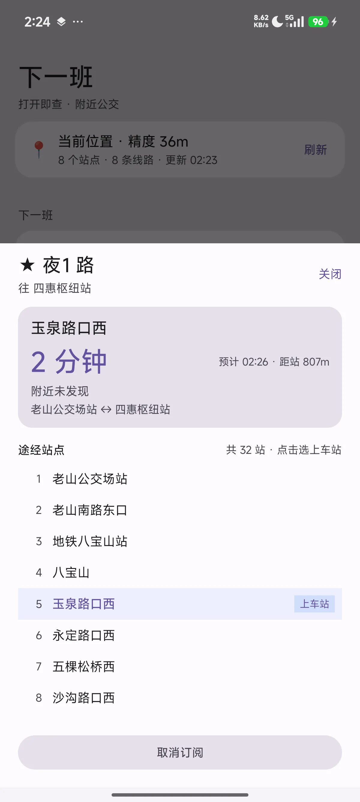
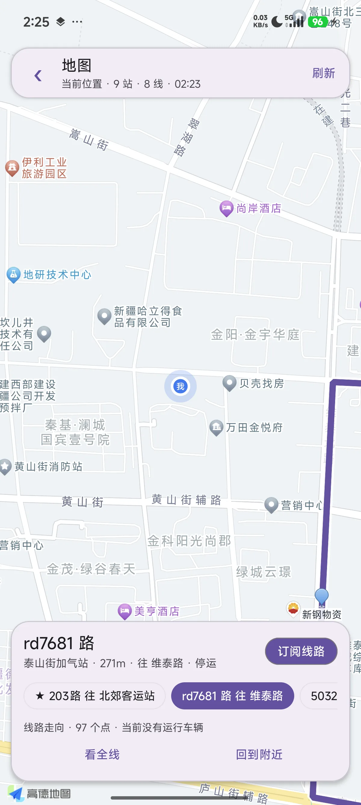

# 下一班 · nextbus

一个打开即用的 Android 公交到站小工具。不跑后台、不发定时通知、不做常驻轮询——需要查车时打开 App，首页第一屏直接回答一个问题：**我订阅的这趟车，下一班还有几分钟。**

<p>
  
  
  
</p>

## 功能

### 下一班，一眼看到

- 首页顶部新增「下一班」大卡：线路、上车站、大号倒计时、预计到站时刻、后一班、距站距离、在线车辆数。
- 自动挑一条订阅线路优先展示；有明确上车站的订阅优先。点卡片直接进线路详情。
- 前台每 20 秒自动刷新；停运时显示「停运 / 不在运营时间」，没有车时显示「暂无车」，不再只显示一个「—」。

### 到站信息贯穿全链路

- **线路详情**：摘要卡直接显示下一班几分钟、预计时刻、后一班和距站；在途经站点里改上车站后立即重查，15 秒刷新。
- **附近线路**：每条线路右侧用 ETA 胶囊徽章显示下一班，而不只是首末班时间。
- **地图**：选线面板显示「下一班 X 分钟 / N 辆车」；在线车辆 marker 也带 ETA 标题。
- 实时解析优先读每辆车 `travels[]` 里目标站的到站时间，过滤已经驶过目标站的车，并按 ETA 排序。

### 上车站可以改

- 打开线路详情，点「途经站点」里的任意一站，即设为该线路该方向的上车站；头部摘要、订阅记录、地图高亮和下次打开都会同步。
- 已订阅线路改站会立即写回订阅，不需要先取消再订阅。
- 在地图上点站点标记，也可以「设为上车站」。
- 线路详情加载失败或站序缺失时不会写入错误的上车站，而是提示重新选择。

### 定位与坐标

- 定位优先高德连续定位，并按精度、时效与定位来源挑选最优点；高德失败时回退系统定位，再失败才用常去地点兜底。
- 只有粗略定位权限时会标明「大致位置」；精度超过 150m 时提示「定位较粗，站点可能不准」，并提供「开启精确位置」入口。
- 接口返回的 WGS-84 坐标在解析边界统一转成 GCJ-02；高德定位、地点和地图统一按 GCJ-02 使用，避免线路、站点、车辆与底图之间整体偏移。
- 城市反查使用 GCJ-02 + `gpstype=gcj`，不再把高德坐标当成 WGS 传给服务端。

### 地图

- 首页、附近页或详情页点「在地图上查看」，蓝色「我」标出当前位置。
- 选中线路后只显示这条线的站点、站名和走向折线，橙色标记标出上车站。
- 在线车辆用绿色「车」标出，并显示最近一辆车的 ETA；支持「看全线 / 回到附近」。
- 车辆坐标与线路、站点使用同一坐标系，不再出现「车不在线路上」的偏移。

### 轻量

- 没有前台服务、精确闹钟、开机自启、通知渠道或后台轮询。
- 查询结果只保存在当前页面内存和最近一次快照中，退出即释放。
- 订阅只按 `lineId + direction` 保存，不绑定地点。

## 构建

需要 JDK 17、Android SDK 33：

```bash
./gradlew assembleDebug
```

Windows：

```bat
gradlew.bat assembleDebug
```

产物在 `app/build/outputs/apk/debug/app-debug.apk`。

高德 Key 可写在 `local.properties`（定位和地图共用；没有 key 时定位回退系统定位，地图入口隐藏）：

```properties
sdk.dir=D:\\Android\\Sdk
amap.key=你的高德Key
```

没有 key 时会回退系统定位。签名配置可选，见 `app/build.gradle.kts`。

### 测试

```bash
./gradlew testDebugUnitTest
```

当前 42 个 JVM 单测，覆盖坐标转换、线路/站点/车辆/实时到站解析、定位质量筛选、附近线路选择与订阅上车站匹配。

## 使用

1. 安装后打开 App。
2. 首次进入会请求定位权限；允许后首页自动查询，顶部「下一班」直接显示订阅线路的到站。
3. 点「下一班」或「附近线路」中的线路，先看详情和途经站点；点任意站点即可改上车站，底部按钮订阅后出现在「我的线路」并置顶。
4. 在「更多 → 城市」里可自动识别、用已设地点或搜索城市名。
5. 「附近公交」页按站点查看全部线路，也可从「查看全部附近站点」进入。
6. 首页、附近页或详情页点「在地图上查看」进入地图；点线路条切换走向，点站点标记查看站名/经过线路或设为上车站；「看全线」隐藏密集站名，「回到附近」恢复。

## 工作方式

- **定位**：`LocationProvider` 先取系统最近一次可用定位，再并行/顺序尝试高德连续定位与系统实时定位，用「精度 + 年龄」打分选最优点，只回调一次。
- **附近**：定位 → 城市识别 → 附近站点 → 并发拉取每站线路 → 合并、去重、排序。同一线路同方向优先保留订阅上车站；未订阅时保留最近站点。
- **坐标**：`GeoDatum` 统一判断 `gpstype/gpsType`（缺省按 WGS），`LineRouteParser`、`NearbyStationsParser`、`BusesParser` 在解析入口转为 GCJ-02；出口请求声明 `gpstype=gcj`。
- **实时到站**：`RealtimeParser` 解析 `encRefreshLineDetail` 的 `travels[]`，优先目标站条目，兼容 `arrivalTime`（毫秒）、`travelTime`（秒）和 `recommTip`（HH:mm），过滤已过站车辆并按 ETA 排序。
- **刷新**：首页 20 秒、详情 15 秒、地图 15 秒；只在前台运行，页面销毁即停止。
- **无后台**：没有通知、闹钟、前台服务或定时任务；高德 SDK 的定位服务只在主动定位时启动。

## 已知限制

- 使用非官方接口，接口字段可能变化；失败时页面保留上一次结果并提示。
- 到站时间来自服务端车辆位置与路况估算，夜间停运或暂无车辆时只能显示「停运 / 暂无车」。
- 定位精度受系统、室内环境和高德 SDK 影响；只有粗略权限时站点距离可能不准。
- 城市识别失败时需要手动在设置里选城市。
- 站点/线路数据以接口返回为准，部分站点可能暂时没有线路数据。
- 地图需要有效的高德 Key；线路走向缺失时只显示站点，不影响列表和订阅。

## 目录

```text
app/                       Android 应用
app/src/main/java/.../     定位、坐标解析、实时到站、页面与地图
app/src/test/java/.../     JVM 单测
docs/protocol.md           接口协议与坐标系实测说明
docs/screenshots/          截图
tools/probe.mjs            接口探测脚本
```

## License

MIT
