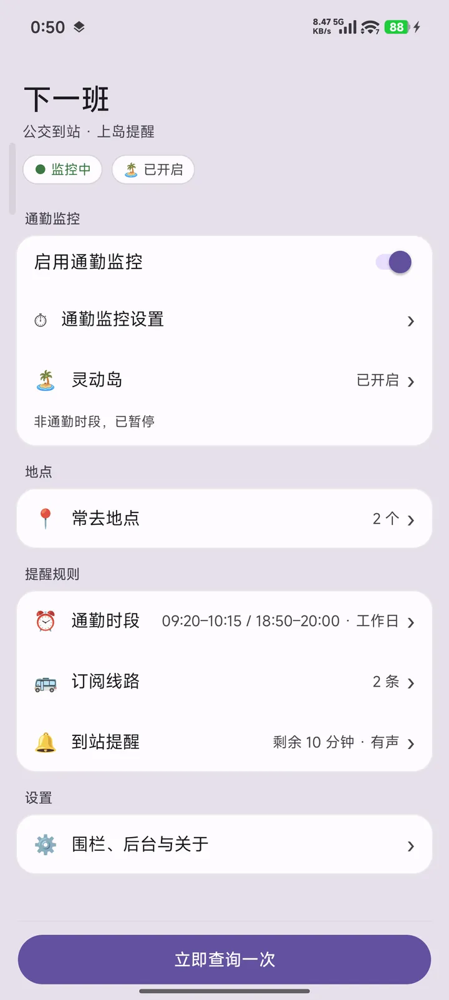
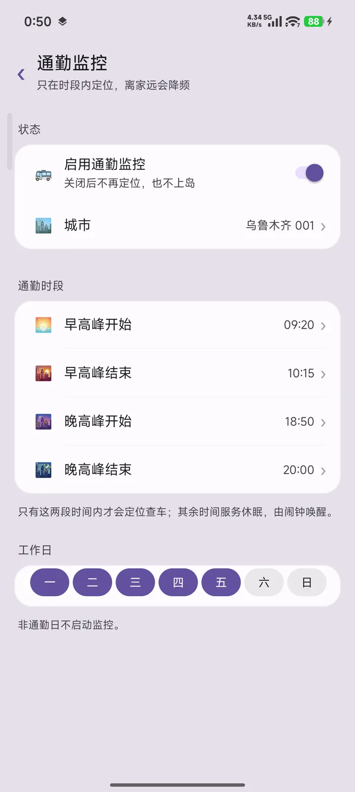
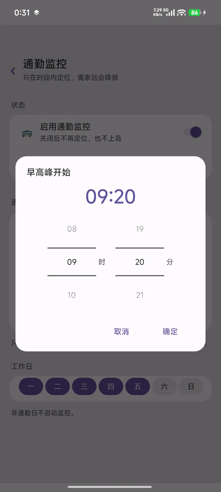

# 下一班 · nextbus

[](https://github.com/KevinZjYang/nextbus/actions/workflows/build.yml)
[](LICENSE)

通勤公交实时到站 + 小米澎湃OS 超级岛提醒。设好家/公司，通勤时段走到附近，自动查车并把「线路 + 还有几分钟」显示在岛上。

  

## 功能

- **通勤监控**：任意地点（家、公司、学校…）各绑线路；只在设定的通勤时段定位，离家远就降频，省电
- **分页设置**：概览 → 通勤监控 / 地点 / 订阅线路 / 到站提醒 / 设置，时间用滚轮选，不再一层层弹窗
- **超级岛**：走媒体通知通道上岛，免小米白名单授权；显示线路名与到站时间
- **附近公交**：进页面直接铺开「站点 → 经过线路 → 到站时间」，陌生地方也能看；也可用当前位置模式
- **到站提醒**：提前 N 分钟弹通知，铃声跟随系统通知管理
- **选点**：POI 搜索 / 高德定位 / 粘坐标；城市自动识别

## 构建

需要 JDK 17、Android SDK（compileSdk 33）。

```bash
git clone https://github.com/KevinZjYang/nextbus.git
cd nextbus
cp local.properties.sample local.properties   # 填 sdk.dir 和 amap.key
./gradlew assembleDebug                        # 产物在 app/build/outputs/apk/debug/
```

`amap.key` 是[高德开放平台](https://lbs.amap.com/)的 Android 定位 Key，需绑定包名 `com.yg.busisland` 与签名 SHA1。不填也能构建，只是定位不可用（会退回系统定位）。

仓库不带签名文件。放 `keystore/busisland.jks` 才会用固定签名（换签名装机会清数据）：

```
alias      busisland
store/key  busisland123
SHA1       7A:8D:B4:69:69:D5:69:70:97:BB:62:5D:94:A5:51:FF:6B:95:C3:1B
SHA256     AE:AC:12:84:06:E7:C0:21:A9:B7:D3:91:DB:07:B2:1B:88:39:B7:53:34:7D:02:BC:72:12:46:52:ED:A0:8C:0A
```

CI（GitHub Actions）每次 push 到 master 会构建 debug 包并作为 artifact 上传。

## 安装与授权

1. `adb install -r app-debug.apk`，首次装完给通知权限（`adb shell appops set com.yg.busisland POST_NOTIFICATION allow`）
2. 设置里打开：自启动、电池优化忽略、省电策略无限制——否则后台会被清
3. 主页「城市」选城市 → 「地点」添加家/公司并选点 → 「订阅线路」绑定线路
4. 「通勤时段」设上下班时间与工作日；「到站提醒」设提前几分钟

## 工作原理

- 主页/服务按通勤时段与围栏调度定位：远则低频、近则按 `刷新间隔`（默认 45s）轮询
- 轮询时把结果渲染成一条常驻通知；支持超级岛的系统会把它显示成岛（走 MediaStyle，外形偏音乐卡片）
- 只查当前最近地点绑定的线路，所有请求都在后台线程，失败保留上次结果

接口协议、签名与加密细节整理在 [docs/protocol.md](docs/protocol.md)。

## 已知限制

- 官方 `miui.focus.param` 模板需要小米白名单（企业主体 + appid），个人开发者走不通，所以用媒体卡片通道，外形是音乐卡片
- 非通勤时段服务会停掉，只留闹钟唤醒；此时岛不更新
- 接口没有公开文档，字段随 App 版本可能变化

## 目录

```
app/                   Android 工程（Kotlin，无 XML 布局）
docs/protocol.md       接口协议整理
docs/screenshots/      截图
tools/probe.mjs        协议探针（Node，无依赖）
```

## 许可证

MIT，见 [LICENSE](LICENSE)。

> 接口参数由样本 APK 逆向分析得到，仅供个人学习与自用，请勿用于商业用途或大规模抓取。
